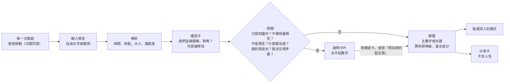
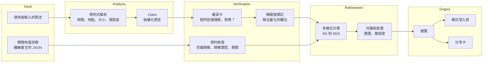

# 我也會地震預測：設計文件

> 狀態：**v1 實作中**。第 10 節的問題已於 2026-11-04 確認，見文末「決策紀錄」。
> 日期：2026-11-04（草案 v0 寫於實務專題 repo 的分支 `claude/earthquake-rumor-stats-web-71eeb4`，之後搬到這個 repo）
> 計算規格：[`MODELS.md`](MODELS.md)（本文件講「做什麼、為什麼」，MODELS.md 講「每個數字怎麼算」）
> 標記：**【事實】** 已由資料或文獻確認；**【理論】** 有文獻支持的模型或推論；**【推測】** 設計判斷或待驗證；**【估算】** 粗略計算

---

## 0. 一句話定義

使用者輸入一則地震預言（例如「某某說下週會大地震」），網頁回答：
**就算完全不懂地震、隨便亂猜，這種預言有多大機率「猜中」？**
並用多種模型、從多個角度解釋為什麼。

畫面先給總覽（主數字、解讀光譜、算命師等級），使用者再點選想深入的模式。

---

## 1. 為什麼做（WHY）

民間預言看起來「很準」，通常來自三個可以量化的原因：

1. **台灣地震本來就多**：1995–2025 年，研究區內 ML ≥ 5 平均每年 39 次【事實，見 3.1】。
2. **預言寫得模糊**：沒說多大、在哪、哪幾天，任何結果都能算「中」。
3. **只有猜中的會被記得**：猜錯的沒人轉傳（倖存者偏差）。

類比：算命師說「你今年會遇到貴人」，命中率本來就很高。網頁要做的事，就是把每則預言換算成「它有多像『你今年會遇到貴人』」。

**和主專題的關係**

| 已有成果 | 位置 | 這個網頁怎麼用 |
|---|---|---|
| 期初提案預期成果 4「民間前兆假說的量化驗證」 | 提案 | 網頁可以作為這項成果的公開展示 |
| 基準率檢查 `base_rate_p`（Poisson、地區代碼表、規模 −0.5 規則） | `prompts/daily-earthquake-report.md` 第 3.2 節 | 網頁的 M2 是同一套公式的互動版 |
| 民間預測紀錄與回測欄位 | `daily-reports` 分支的 `data/` | M11「真實戰績」的資料來源 |
| Gardner–Knopoff 去群聚、Molchan 圖、ASS | `claude/b3-baseline-model-6e563a` 的 `pipeline/src/eqforecast/` | 離線前處理與 M11 可沿用（該分支尚未合併到 `main`） |

---

## 2. 先釐清的三件事

### 2.1 「單純隨機」有兩種，答案不同

| | A. 預言固定，地震照常發生 | B. 地震固定，預言隨機亂發 |
|---|---|---|
| 回答的問題 | 這則預言「本來就會中」的機率 | 一個亂猜的人，戰績能有多好看 |
| 適用 | 單一則預言（網頁主功能） | 一連串預言的戰績（進階模式） |
| 做法 | 用地震發生率模型（Poisson、ETAS…）算窗口內至少一次的機率 | 把預言日期隨機打散，對真實地震目錄重算命中數 |
| 依據 | 每日報告第 3.2 節 | Stark (1997)、Luen & Stark (2008) |

【理論】答案取決於「隨機」用哪一種模型（虛無假設）。Michael (1997) 用不同群聚程度的模擬目錄檢驗同一個預測方法，發現群聚性不足的虛無模型，會讓預測方法看起來比實際更顯著。

所以「很多模式」不只是好玩，而是科學上必要：不同模型給不同答案，網頁要把差異攤開，而不是只給一個看似精確的數字。

### 2.2 「猜中」要先定義

| 維度 | 謠言常見寫法 | 預設解讀（使用者可改） |
|---|---|---|
| 時間 | 「下週」「近期」「這個月」 | 「下週」= 發布日的下週一～週日；「一週內」= 發布日起 7 天；「近期」→ 標註**無法量化**，暫用 30 天並提醒 |
| 地點 | 「台灣」「花蓮外海」「日本」 | 沒寫 → 台灣及近海（21–26°N、119–123°E），並標註「範圍未指定」 |
| 大小 | 「大地震」「規模 6」「6 級」 | 沒寫數字 → 顯示整條**解讀光譜**（3.2）；「N 級」有歧義（台灣多指震度、中國媒體多指規模），請使用者選 |
| 寬鬆度 | 「M7」「M7 以上」 | 沿用每日報告規則：只寫單一數值 → 下限 −0.5；寫「以上」→ 不放寬；兩種結果並列 |

### 2.3 這不是地震預報

網頁算的是**背景機率**：任何一週都差不多，不代表「這週特別危險」。

例外是 ETAS（M7），它算的是「當下」的機率，性質上接近餘震預報，而官方餘震資訊以中央氣象署為準。所以 v1 不做「今天」的即時機率，ETAS 先只做歷史日期的「時光機」（見第 9、11 節）。

---

## 3. 可行性試算（實際資料）

以下數字全部由 [`tools/feasibility.py`](../tools/feasibility.py) 計算：

```bash
EQ_DATA_DIR=<含 E-A0073-002 與 earthquake_data 的資料夾> python tools/feasibility.py taiwan
python tools/feasibility.py template   # 需連網（USGS）
python tools/feasibility.py template --regions TW   # 只算台灣，對照用
```

兩種機率的意思：

- **Poisson**：假設地震以固定速率、彼此獨立地發生，P = 1 − e^(−λT)。
- **歷史實際**：把過去每一天都當成預言的起點，數「長度 T 天的窗口裡至少有一次地震」的比例。

### 3.1 台灣：規模門檻 × 窗口長度【事實】

CWA 地震目錄（E-A0073）1995–2025，研究區 21–26°N、119–123°E，共 63,669 筆，31.00 年。

| 門檻 | 事件數 | 年發生率 | 7 天 Poisson | 7 天 歷史實際 | 30 天 Poisson | 30 天 歷史實際 |
|---|---|---|---|---|---|---|
| ML ≥ 4.0 | 9958 | 321.22 | 99.8% | 97.0% | 100.0% | 100.0% |
| ML ≥ 4.5 | 3562 | 114.90 | 88.9% | 75.4% | 100.0% | 99.7% |
| ML ≥ 5.0 | 1223 | 39.45 | 53.0% | 41.2% | 96.1% | 86.7% |
| ML ≥ 5.5 | 375 | 12.10 | 20.7% | 16.0% | 63.0% | 51.3% |
| ML ≥ 6.0 | 126 | 4.06 | 7.5% | 5.9% | 28.4% | 23.2% |
| ML ≥ 6.5 | 35 | 1.13 | 2.1% | 1.6% | 8.9% | 6.7% |
| ML ≥ 7.0 | 7 | 0.23 | 0.4% | 0.4% | 1.8% | 1.4% |

讀法：「下週台灣會有規模 5 以上」── 過去 31 年，任選一天開始的 7 天裡，有 41.2% 真的發生；Poisson 算出 53.0%。

**Poisson 在短窗口會高估**：地震成群發生，很多「有地震的週」其實一週好幾次，所以「至少一次」的週數比固定速率模型少。這個差距是 M1 和 M2 並列的理由。

### 3.2 同一句「下週會大地震」的解讀光譜【事實】

| 「大地震」的解讀 | 7 天內至少一次（歷史實際） | 資料 |
|---|---|---|
| 有感地震（全台任一地點震度 ≥ 1） | 94.6% | 有感地震彙整 |
| 全台最大震度 ≥ 3 | 91.3% | 有感地震彙整 |
| ML ≥ 4.5 | 75.4% | CWA 目錄 |
| 全台最大震度 ≥ 4 | 64.8% | 有感地震彙整 |
| ML ≥ 5.0 | 41.2% | CWA 目錄 |
| 全台最大震度 ≥ 5（2020 年後為 5 弱以上） | 18.5% | 有感地震彙整 |
| ML ≥ 5.5 | 16.0% | CWA 目錄 |
| ML ≥ 6.0 | 5.9% | CWA 目錄 |
| 全台最大震度 ≥ 6（2020 年後為 6 弱以上） | 2.6% | 有感地震彙整 |
| ML ≥ 6.5 | 1.6% | CWA 目錄 |
| ML ≥ 7.0 | 0.4% | CWA 目錄 |

**同一句話，依「大」的定義，瞎猜命中率從 0.4% 到 94.6%，相差兩百多倍。**
所以預言沒寫規模時，總覽頁的主角應該是這條光譜，而不是單一數字。

### 3.3 大地震之後：搭順風車【事實】

在每次 ML ≥ 6.0 地震（共 126 次）的隔天預言「接下來一週還會有」，窗口為地震後第 1～8 天：

| 預言內容 | 條件機率 | 平時（歷史實際） | 倍數 |
|---|---|---|---|
| ML ≥ 5.0 | 75/126 = 59.5% | 41.2% | 1.4× |
| ML ≥ 5.5 | 40/126 = 31.7% | 16.0% | 2.0× |
| ML ≥ 6.0 | 20/126 = 15.9% | 5.9% | 2.7× |

這就是 ETAS 要處理的效應：大地震後，猜「還會有」容易很多。

### 3.4 真實案例：重複發布的 9 國範本【事實】

每日報告的 `data/predictions.jsonl` 已收錄 quakeforecast 3 則同範本預言（10/22、10/24、10/27 發布），內容都是「30 天以內、日本／台灣／大陸／緬甸／尼泊爾／菲律賓／印尼／馬來西亞／巴布亞紐幾內亞、M7.0」，已依第 3.1(a) 節合併成一個群組，合併窗口 10/22–11/26（約 35 天）。

USGS 2016-11-04～2026-11-04，9 個地區的經緯度範圍聯集（範圍取自每日報告的地區代碼表）：

| 規模門檻 | 空間判定 | 事件數 | 年發生率 | 30 天 Poisson | 30 天 歷史實際 | 35 天 Poisson | 35 天 歷史實際 |
|---|---|---|---|---|---|---|---|
| M ≥ 7.0（嚴格） | 經緯度範圍 | 47 | 4.7 | 32.0% | 33.4% | 36.3% | 37.7% |
| M ≥ 7.0（嚴格） | place 字串 | 45 | 4.5 | 30.9% | 32.2% | 35.0% | 36.3% |
| M ≥ 6.5（±0.5） | 經緯度範圍 | 136 | 13.6 | 67.3% | 62.4% | 72.8% | 68.0% |
| M ≥ 6.5（±0.5） | place 字串 | 129 | 12.9 | 65.3% | 61.2% | 71.0% | 66.6% |

- 單一則預言：嚴格判定約 31–33%；套用 ±0.5 後約 61–67%。**光是「判定寬鬆」就讓瞎猜命中率約翻倍。**
- 範圍的影響：同樣的資料、同樣 M ≥ 6.5，只算台灣（`--regions TW`）10 年只有 5 次，30 天命中率 3.3%（歷史實際）～4.0%（Poisson）；9 個地區合起來就是 61–67%。
- 合併後的群組（約 35 天）：約 67–73%。
- 若全年持續發布（每兩三天一次），等於隨時都有一則預言「有效」。以每群組約 35 天、命中率約 0.68 估算，一年約有 365.25 ÷ 35 × 0.68 ≈ 7 個群組會「命中」【估算】。

### 3.5 這些數字的限制

- **未去群聚**，且窗口彼此重疊，不能當成獨立樣本算信賴區間（實作時改用區塊拔靴法）。
- **完備規模隨年代變動**（GDMS 分析報告：1990 年代 Mc ≈ 2.25、2010 年代 ≈ 1.35）。本表從 1995 年、ML ≥ 4 起算以降低影響；東部外海的完備度可能較差【推測】。
- **震度**：2020 年起 5、6 級拆成弱／強，本表把 5 弱視為 5、6 弱視為 6。而且這是「全台任一地點的最大震度」，不是某個縣市的震度。
- **大地震樣本少**：ML ≥ 7.0 在 31 年只有 7 次，高門檻要靠規模–頻率模型（M3）補強。
- **規模類型不可混用**：台灣用 CWA 的 ML，國際用 USGS 的 Mw（沿用每日報告規則）。
- **USGS 資料會修訂**：3.4 的數字以 2026-11-04 查詢結果為準。

---

## 4. 核心概念：預言灌水六大手法

這是整個網頁的概念骨架：總覽頁的「灌水成分」、每個模式的切入點，都對應到這六項。

| # | 手法 | 例句 | 效果（實例） | 對應模式 |
|---|---|---|---|---|
| 1 | 時間拉長 | 「近期」「這個月」 | ML ≥ 5.5：7 天 16.0% → 30 天 51.3%（3.1） | M2、M4 |
| 2 | 範圍放大 | 「亞洲 9 國」 | 30 天、M ≥ 6.5（同一份 USGS 資料）：只算台灣 3–4% → 9 國 61–67%（3.4） | M5 |
| 3 | 門檻模糊或降低 | 「大地震」「有感」 | 0.4%～94.6%（3.2） | M3、M4 |
| 4 | 判定寬鬆 | 「M7」→ 6.5 也算 | 約 31–33% → 61–67%（3.4） | M4 |
| 5 | 亂槍打鳥 | 每兩三天重發一次 | 一年約 7 個群組「命中」（3.4，估算） | M8、M9 |
| 6 | 搭順風車 | 大地震隔天說「還會有」 | ML ≥ 6.0：5.9% → 15.9%（3.3） | M6、M7 |

「灌水成分」的算法是**反事實比較**：例如「如果他說的是『花蓮 50 km 內』而不是『全台灣』，命中率會從 X 降到 Y」。

---

## 5. 使用流程與畫面

### 5.1 流程



**為什麼要把關**：解析器一定會產生一個解讀（沒說的部分用預設值補），所以亂打的字、說的是歐洲的預言，也會得到一個看起來很精確的數字。對一個講求「誠實」的網站，這比算錯還糟。判斷規則見 `docs/MODELS.md` 2.7。

### 5.2 總覽頁（由上到下）

1. **確認卡**：時間、地點、大小、寬鬆度都可以直接改；原文裡被採用的字句會標出顏色，沒說清楚的地方寫在確認卡最下面的提醒裡。用了中央氣象署的分級名稱（中地震、弱震、小區域有感地震…）時，提醒裡附上官方定義。
2. **主數字**：「就算隨便亂猜，這種預言也有約 41% 會中」，下面一行換算成「平均每猜 N 次，就會中 1 次」；預言沒寫規模時，改成「0.4%～94.6%，看你怎麼定義『大』」，下面接解讀光譜。主數字下方固定一段「這不是預報」的說明。
3. **生活換算**：「≈ 擲硬幣出現正面」（5.4）。
4. **算命師等級**徽章（5.3）。
5. **解讀光譜**（只有沒說多大時）：預言用了「大地震」「強震」這類有官方定義的詞時，標出「官方定義」那一列。
6. **對照組**：五句固定的預言（由寬鬆到精確）和這則預言排在一起，一眼看出算高還是低。
7. **模型共識條**：各模式的結果畫在同一條 0–100% 的軸上，一眼看出範圍。
8. **灌水成分**：這則預言用了第 4 節的哪幾招、各灌了多少。
9. **要連中幾次才值得相信**（M10）。
10. **深入按鈕**：每個模式一張卡，點開看公式、圖表、假設與資料來源。
11. **為什麼預言常常看起來很準？**：五個原因（地震本來就多、寫得模糊、只記得猜中的、一直重複說、事後重新解讀），不論有沒有結果都看得到。

**顯示設定**（頁首）：主題（跟隨系統、白天、黑夜、沙漠黃、叢林綠、科技藍）與版面（單欄；螢幕 ≥ 1100px 時可選雙欄：左邊輸入與確認卡、右邊結果。兩欄都固定在畫面上、各自捲動，改確認卡的任何一項時，右邊的主數字都還在畫面上）。設定與「已同意使用規範」只存在這台裝置的瀏覽器（localStorage），不存任何輸入內容；讀不到時用預設值，只是下次還會再問一次。每套主題的對比由 `tests/theme-contrast.test.ts` 直接讀樣式表檢查（文字 ≥ 4.5:1、圖形 ≥ 3:1）。

### 5.3 算命師等級（草案，門檻與名稱可調）

| 瞎猜命中率 | 等級 | 意思 |
|---|---|---|
| ≥ 90% | 🔮 你今年會遇到貴人 | 幾乎必中，猜中不代表任何能力 |
| 50–90% | 你最近有點煩惱 | 冷讀術等級，猜中很正常 |
| 20–50% | 擲硬幣 | 猜中算運氣不錯，但不稀奇 |
| 5–20% | 有點東西 | 單次猜中值得記一筆，還要看他猜過幾次 |
| 1–5% | 稀有 | 猜中會讓人驚訝，值得認真檢驗 |
| < 1% | 神諭 | 真的猜中、而且只猜這一次，才是值得研究的訊號 |

### 5.4 生活機率換算（全部是精確機率，不需要外部資料）

| 機率 | 等價事件 |
|---|---|
| 97.2% | 擲兩顆骰子，不是兩顆都 6 點（35/36） |
| 83.3% | 擲一顆骰子，不是 6 點 |
| 75% | 擲兩次硬幣，至少一次正面 |
| 50% | 擲硬幣出現正面 |
| 33.3% | 擲骰子出現 1 或 2 |
| 25% | 從撲克牌抽到紅心 |
| 16.7% | 擲骰子出現 6 |
| 8.3% | 猜中陌生人的生日月份（假設生日平均分布） |
| 2.8% | 擲兩顆骰子都是 6 |
| 1.9% | 從整副撲克牌抽中指定的一張 |
| 0.27% | 猜中陌生人的生日是哪一天（同上假設） |

---

## 6. 模式清單（演算法）

### 6.1 總表

| 代號 | 模式 | 回答的問題 | 方法 | 版本 |
|---|---|---|---|---|
| **A 組** | **這則預言本身有多容易中** | | | |
| M1 | 歷史回放 | 過去同樣長度的窗口，有幾成真的發生？ | 滑動窗口計數（不需模型，自動包含群聚） | v1 |
| M2 | 固定速率（Poisson） | 地震若以平均速率隨機發生？ | 1 − e^(−λT)，λ 附信賴區間 | v1 |
| M3 | 規模–頻率（G-R） | 門檻提高 0.5 或 1 級，機率掉多少？ | log₁₀N = a − bM，最大概似估 b | v2 |
| M4 | 解讀光譜／敏感度矩陣 | 換個說法，機率差多少？ | 時間 × 門檻 × 地區的格點計算 | v1 |
| M5 | 空間放大鏡 | 範圍縮到某縣市或半徑 50 km 會怎樣？ | 地圖上畫範圍，重算 M1／M2 | v2 |
| M6 | 餘震效應（Reasenberg–Jones） | 大地震後猜「還會有」容易多少？ | Omori–Utsu × G-R 的封閉解 | v2 |
| M7 | ETAS 時光機 | 選一個歷史日期，當時的機率是多少？ | 時間 ETAS 條件強度＋模擬（含次級餘震） | v2 |
| **B 組** | **預言者能不能「看起來很準」** | | | |
| M8 | 亂槍打鳥 | 發 N 次預言，至少中一次的機率？ | 1 − Π(1 − pᵢ)；窗口重疊時改用模擬 | v1 |
| M9 | 萬名假先知 | 一萬個亂猜的人，最幸運的有多「準」？ | 蒙地卡羅：隨機打散預言日期，對真實目錄計分 | v2 |
| M10 | 要連中幾次才可信 | 猜中一次，該多相信他？ | 貝氏概似比 | v1 |
| M11 | 真實戰績 | 某個來源的命中率，有比亂猜好嗎？ | 每日報告回測＋Poisson-二項檢定、Molchan 圖 | v3 |
| **C 組** | **換算、比較與玩法** | | | |
| M12 | 生活換算＋算命師等級 | 這個機率像什麼？ | 5.3、5.4 的對照表 | v1 |
| M13 | 資訊量 | 這則預言提供多少資訊？ | −log₂ p（bits） | v1 |
| M14 | 模型比較總表 | 為什麼不同模型答案不同？ | 並列各模式的結果與假設 | v1（隨模式增加） |
| M15 | 反向：預言產生器 | 想要 90% 會中，該怎麼寫？ | 在計算結果中找出符合目標的說法，附上實際命中率 | v2 |

### 6.2 各模式的計算方式

**M1 歷史回放**

$$\hat P = \frac{1}{N}\sum_{d} \mathbb{1}\left[\exists\, e:\ t_e \in [d,\ d+T)\right]$$

d 跑遍資料期間的每一天，N 是窗口數。窗口重疊，所以不確定性用區塊拔靴法（區塊長度 ≥ T）估計。

**M2 固定速率（Poisson）**

$\lambda = n / Y$（n 事件數、Y 年數），$P = 1 - e^{-\lambda T}$。λ 的 95% 區間用 Poisson 精確區間（卡方分位數）求得，再代入 P。

**M3 規模–頻率（Gutenberg–Richter）**

$\log_{10} N(\ge M) = a - bM$，b 值用 Aki–Utsu 最大概似估計：$\hat b = \dfrac{\log_{10} e}{\bar M - (M_c - \Delta M / 2)}$。

用途：大地震次數太少時（ML ≥ 7 只有 7 次），用較小地震的速率外推，並顯示 b 值不確定性造成的範圍。注意 b 值對 Mc 很敏感（GDMS 分析報告：0.765～0.937）。

**M6 餘震效應（Reasenberg–Jones）**

主震規模 $M_m$ 之後 t 天、規模 ≥ M 的餘震速率：$\lambda(t, M) = 10^{\,a + b(M_m - M)}\,(t + c)^{-p}$。
窗口 $[t_1, t_2]$ 內的期望數 $N = \int_{t_1}^{t_2} \lambda\, dt$，$P = 1 - e^{-N}$。參數先用文獻通用值示範，再用台灣目錄離線擬合。

**M7 ETAS 時光機（時間版）**

$$\lambda(t) = \mu + \sum_{t_i < t} K\, e^{\alpha (M_i - M_c)}\, (t - t_i + c)^{-p}$$

- 參數離線估計（Python；可評估 [lmizrahi/etas](https://github.com/lmizrahi/etas) 套件，或自寫最大概似）。
- 瀏覽器內用 Web Worker 模擬未來窗口（含餘震再引發餘震），得到「至少一次」的機率。
- 和 M1 比較：**機率增益** = P_ETAS ÷ P_平時。
- 時光機：選歷史日期（例如 2024-04-03 花蓮地震隔天），只用那天以前的資料計算。

**M8 亂槍打鳥**

$P(\text{至少中一次}) = 1 - \prod_{i=1}^{n} (1 - p_i)$，期望命中數 $= \sum p_i$。
窗口重疊或碰上同一個地震序列時，各次預言不獨立，改用 M9 的模擬。

**M9 萬名假先知**

保留預言的「形狀」（窗口長度、地區、門檻、發文次數），把發布日期在歷史期間內隨機打散，對真實目錄計分；重複一萬次得到命中數分布，看真實紀錄落在第幾百分位。這是 2.1 的 B 型檢定，也能展示「最幸運的 1% 看起來有多神」。

**M10 要連中幾次才可信（貝氏）**

猜中一次的概似比：$LR = \dfrac{P(\text{hit} \mid \text{skill})}{P(\text{hit} \mid \text{chance})} \le \dfrac{1}{p_0}$。
連中 k 次、沒有失誤：後驗勝算 = 先驗勝算 × $LR^k$。所需次數：

$$k = \left\lceil \frac{\ln(\text{target odds} / \text{prior odds})}{\ln(1 / p_0)} \right\rceil$$

範例（先驗 1% 相信他有能力、目標 95% 把握、假設有能力的人每次都中；p₀ 取 3.1、3.2 的 7 天歷史實際值）：

| 預言 | p₀ | 需要連中 | 資訊量（M13） |
|---|---|---|---|
| 下週台灣會有感地震 | 94.6% | **136 次** | 0.08 bit |
| 下週 ML ≥ 4.5 | 75.4% | 27 次 | 0.41 bit |
| 下週 ML ≥ 5.0 | 41.2% | 9 次 | 1.28 bits |
| 下週 ML ≥ 6.0 | 5.9% | 3 次 | 4.08 bits |
| 下週 ML ≥ 7.0 | 0.4% | 2 次 | 7.97 bits |

網頁上先驗、目標、能力者命中率都做成滑桿。

**M11 真實戰績**

讀每日報告的 `data/backtest.csv`（每個群組一列，含 `base_rate_p`），比較實際命中數和「各群組 `base_rate_p` 加總」的期望值，用 Poisson-二項分布算 p 值；樣本夠多時畫 Molchan 圖（沿用 B3 的 `metrics.py`）。
目前 `backtest.csv` 只有標頭，第一個群組要 11/26 窗口結束後才結算，需要累積數個月才有意義。

**M13 資訊量**

$I = -\log_2 p_0$（bits）。擲一次硬幣是 1 bit；「下週台灣會有感地震」只有 0.08 bit。

---

## 7. 系統架構

### 7.1 資料夾（v1 實際結構）

```text
i-can-predict-quakes/
├── index.html
├── src/
│   ├── core/                   # 型別契約、常數、縣市表、台灣日期換算
│   ├── claim/                  # 謠言解析：時間、地點、大小 → Claim（規則式）
│   ├── modes/                  # 各模式的計算（只回傳數字與代碼）
│   ├── data/                   # 載入 public/data/*.json
│   ├── app/                    # 狀態、網址同步、輸入把關（quality）、顯示設定（prefs）
│   ├── ui/                     # 總覽、確認卡、模式卡、SVG 圖表
│   └── copy/                   # 所有給使用者看的文字（zh-TW）
├── public/data/                # 離線產生的 JSON（進版控，附來源與資料版本）
├── tests/                      # Vitest：解析器、公式、與 Python 對照答案比對
├── tools/                      # Python：build_data.py、golden.py、feasibility.py
├── docs/                       # DESIGN.md（本文件）、MODELS.md（計算規格）
└── .github/workflows/deploy.yml  # 測試 → 建置 → 部署 GitHub Pages
```

v2 才需要的 `fit_params.py`（G-R、R&J、ETAS 參數）和 Web Worker（蒙地卡羅）到時再加。

**為什麼是純靜態網站**：不需要伺服器，所以不用付費、不會被灌爆、也不會收集使用者輸入；所有計算都在使用者的瀏覽器裡完成。

### 7.2 管道



### 7.3 模式介面（草稿）

每個模式都是獨立模組，新增模式不用改其他程式：

```ts
interface Claim {
  issuedAt: string;                                   // 預言發布日（預設今天）
  window: { start: string; end: string; source: 'parsed' | 'default' | 'user' };
  region: RegionRef;                                  // 預設地區、圓形或多邊形
  size: { kind: 'ML' | 'Mw' | 'intensity'; min: number | null; tolerance: number };
  flags: string[];                                    // 例如「規模未指定」「時間無法量化」
}

interface ModeResult {
  p: number | null;                                   // 點估計；光譜類模式為 null，改看 series
  interval?: [number, number];                        // 不確定性範圍
  series?: { label: string; p: number }[];            // 光譜、敏感度矩陣等多值結果
  assumptions: string[];                              // 卡片上顯示的假設
  provenance: { dataset: string; period: string; nEvents: number };
  nature: 'fact' | 'model' | 'assumption';            // 對應【事實】【模型估計】【假設】
}

interface Mode {
  id: string;                                         // 'M1'…
  title: string;
  question: string;                                   // 這個模式回答的問題
  tier: 1 | 2 | 3;                                    // v1／v2／v3
  compute(claim: Claim, data: DataBundle): ModeResult | Promise<ModeResult>;
}
```

### 7.4 資料來源與取得方式

| 資料 | 用途 | 授權／限制 | 前端怎麼拿 |
|---|---|---|---|
| CWA 地震目錄 E-A0073（1990–2025，ML ≥ 3.0） | 台灣的所有模式 | 開放資料，須註明出處；CWA 多數資料集標示「政府資料開放授權條款－第 1 版」，**本資料集的授權欄位待確認** | 離線轉成精簡 JSON（預估數萬筆、壓縮後數百 KB【推測】） |
| CWA 有感地震彙整（最大震度） | 震度類解讀 | 原始出處與授權待確認 | 同上 |
| USGS ComCat | 國際地區（Mw） | 美國政府資料（公有領域）；API 允許瀏覽器跨網域存取（已實測 `Access-Control-Allow-Origin: *`） | v2 直接查詢或離線快取 |
| CWA 開放資料 API | v3「今天」模式的最新事件 | 需授權碼，**不可**放前端（已實測未帶授權碼回 401） | GitHub Actions 以 Secret 每日更新 JSON（沿用每日報告的保密規則） |
| GDMS 目錄 | 不直接使用 | 再散布條款不明 | 不放進網站 |

---

## 8. 驗證層

| 檢查 | 做法 | 防止什麼 |
|---|---|---|
| 數字只由程式產生 | 說明文字用模板＋變數，不手寫數字（沿用每日報告「數值一律由程式計算」原則） | 文字和計算不一致 |
| 解析器測試集 | 蒐集 ≥ 50 句真實或仿真的謠言句型（含「N 級」歧義、「近期」、外海地名），每句寫好預期的 Claim | 解析錯誤 |
| 公式單元測試 | Poisson、R&J 積分、M10 所需次數等有解析解的，和手算值比對 | 公式寫錯 |
| 跨語言黃金檔 | 同一組 Claim，Python（`tools/`）和 TypeScript（`web/`）結果誤差 < 1e-9；蒙地卡羅用固定種子、以統計容許範圍比對 | 前端實作偏離 |
| 校準檢查 | 把 Poisson、ETAS 對歷史每週的預測機率，和實際有沒有發生比對（可靠度圖），結果寫進 `MODELS.md` | 模型本身不可靠卻沒人發現 |
| 來源標示 | 每張卡片顯示資料集、期間、事件數、規模類型、假設，並標【事實】【模型估計】【假設】 | 讀者分不清事實和模型 |

---

## 9. 風險與對策

| 風險 | 說明 | 對策 |
|---|---|---|
| 被誤讀成預報、引發恐慌 | 「下週 41%」可能被截圖成「下週 41% 會大地震」 | 主標題寫「隨便猜也會中的機率」；同時寫「過去 31 年有 41% 的週都發生過」；主數字下方固定寫「這不是地震預報」；第一次使用要先勾選同意使用規範；不用警報式紅色；附中央氣象署與防災資訊連結；v1 不做「今天」的即時機率 |
| 垃圾輸入也得到精確數字 | 亂打的字、國外的預言、什麼都說的預言，解析器照樣補成一個解讀 | 輸入把關（`docs/MODELS.md` 2.7）：先顯示說明卡片，使用者確認後才給數字 |
| 專有名詞誤讀 | 「中地震」「弱震」「小區域有感地震」是中央氣象署有定義的名詞；「台中地震」不是「中地震」 | 依地震百問的定義換算並在確認卡附上定義；「大地震」「強震」口語太常見，照樣看光譜；含「中」的名詞前面是「台」時不算 |
| 解讀偏差 | 「大地震」「附近」沒有標準定義 | 永遠顯示解讀、可以修改；沒寫規模時顯示整條光譜 |
| 統計誤用 | 窗口重疊造成過窄的信賴區間；未去群聚；樣本少 | 區塊拔靴法；從沒發生過時改用 Poisson 上限並標示（v1）；並列去群聚前後、事件少時改用 G-R（v2 計畫） |
| 資料不一致 | ML／Mw 混用；時區（CWA +08:00、GDMS UTC）；完備規模變動 | 台灣只用 CWA ML（國際的 USGS 是 v2 計畫）；時間存成 Unix 秒、一律換成台灣的日期計算；門檻下限 ML 4.0、期間從 1995 年起 |
| 點名與誹謗 | 使用者輸入真實人名；分享卡被拿去攻擊特定人 | 分享文字與連結只有解讀、不含原文與人名；不儲存輸入；「真實戰績」已決定不點名真實來源（Q6） |
| 授權與標示 | 再散布資料 | 只放 CWA 開放資料的衍生精簡檔並註明出處；不放 GDMS 原始資料 |
| 金鑰外洩 | CWA API 授權碼 | 只放 GitHub Actions Secret |
| 範圍膨脹 | 15 個模式 | 分三期；v1 只做公式簡單、風險低的 8 個 |
| 手機效能 | 蒙地卡羅一萬次 | Web Worker、逐步顯示結果、限制模擬次數 |
| 排擠主專題時間 | 主專題 B2 之後的任務約落後 2–3 週（`docs/PROJECT_OVERVIEW.md` 5.1） | 定位成預期成果 4 的一部分；v1 控制在小範圍（Q1） |

---

## 10. 待確認問題（已於 2026-11-04 確認，答案見「決策紀錄」）

| # | 問題 | 選項 | 建議 |
|---|---|---|---|
| Q1 | 定位 | (a) 算進實務專題（預期成果 4）／(b) 獨立作品集 | **(a)**：可直接沿用每日報告和 B3 的成果，口試也多一個能現場展示的東西 |
| Q2 | 程式放哪 | (a) 這個 repo 的 `web/`（已公開，可直接開 GitHub Pages，網址 `azazelowo.github.io/earthquake-risk-project/`）／(b) 另開新 repo | 跟著 Q1：算進專題選 **(a)**；純作品集選 (b)，網址較好記 |
| Q3 | 輸入方式 | (a) 規則式解析＋可修改的確認卡／(b) 再加 LLM 解析 | **(a)**：免費、離線、可解釋。(b) 需要後端和 API 費用，公開後有被濫用的風險，可留到 v3 |
| Q4 | v1 地區 | (a) 只做台灣（CWA ML）／(b) 台灣＋國際（USGS Mw） | **(a)**：資料最完整、和主專題一致；國際放 v2 |
| Q5 | 技術 | (a) Vite + TypeScript 靜態網站／(b) 單一 HTML 檔／(c) Streamlit | **(a)**：符合 AGENTS.md 偏好、模組化、可測試、手機體驗好。(c) 和主專題 C2 同技術，但公開分享和手機體驗較差 |
| Q6 | 「真實戰績」要不要點名真實來源 | 點名並附原文連結／匿名（來源 A、B）／不做 | 先**匿名**，累積足夠樣本、確認呈現方式後再決定 |
| Q7 | 介面語言 | 只做繁中／繁中＋英文 | 先**繁中**，文字集中管理，之後再加英文 |
| Q8 | 網站名稱 | 例：「這預言準嗎？」「瞎猜也會中」「地震算命攤」 | 由你決定 |

---

## 11. 分期路線圖

| 期 | 內容 | 工作量 |
|---|---|---|
| **v1：先上線給大家玩** | 規則式解析＋確認卡（台灣）；總覽頁（主數字或光譜、算命師等級、生活換算、灌水成分、所需連中次數）；M1、M2、M4、M8、M10、M12、M13、M14；CWA 資料轉精簡 JSON；測試＋GitHub Pages 自動部署 | 中 |
| **v1.1（2026-11-05，已完成）** | 試玩回報修正：輸入把關、官方分級名稱、鄉鎮名稱、使用規範、六種主題、雙欄版面、對照組、「為什麼看起來很準」、更多資料來源與授權連結 | 小 |
| **v2：更多模型** | M3、M5（地圖）、M6、M7（ETAS 時光機）、M9、M15；分享卡；國際地區（USGS） | 高（ETAS 擬合與模擬最花時間） |
| **v3：接上真實世界** | M11 真實戰績（讀每日報告回測）；「今天」模式（GitHub Actions 每日更新）；選配：LLM 解析、英文版 | 中 |

---

## 決策紀錄

| 日期 | 決定 | 理由 |
|---|---|---|
| 2026-11-04 | Q1：算進實務專題，對應預期成果 4「民間前兆假說的量化驗證」 | 使用者決定 |
| 2026-11-04 | Q2：另開新 repo `i-can-predict-quakes` | 使用者決定：網址比較好記。部署時 `BASE_PATH` 取自 repo 名稱，改名不必改程式 |
| 2026-11-04 | Q3：規則式解析＋可修改的確認卡 | 使用者決定 |
| 2026-11-04 | Q4：v1 只做台灣 | 使用者決定 |
| 2026-11-04 | Q5：Vite + TypeScript 靜態網站，圖表自己畫 SVG | 使用者交由我們決定。理由見第 7 節；不用圖表套件以減少相依 |
| 2026-11-04 | Q6：畫面上不點名真實預言來源；測試可用其範本句型 | 使用者決定 |
| 2026-11-04 | Q7：先做繁體中文 | 使用者決定；文字集中在 `src/copy/zh-TW.ts` |
| 2026-11-04 | Q8：網站名稱「我也會地震預測」 | 使用者決定 |
| 2026-11-04 | 地區改用「縣市界（內政部）＋外推距離」，取代圓形範圍；預設外推 30 公里、提到外海時 60 公里、上限 60 公里 | 語意接近新聞說的「花蓮外海地震」；距離在 `tools/build_data.py` 預先算好，網頁與獨立驗證程式查同一張表，結果不會因幾何實作不同而有出入 |
| 2026-11-04 | 資料期間 1995–2025、最低 ML 4.0 | 完備規模隨年代變動；門檻低於 4.0 時以 4.0 計算，實際命中率只會更高 |
| 2026-11-04 | 2014 年 35 筆缺最大震度的小區域有感地震記為 1 級 | 有感代表至少 1 級；記為 1 不會灌高較高門檻 |
| 2026-11-04 | 網站主數字用 M1 歷史回放（不用 Poisson） | 不依賴模型假設、最直觀；M2 並列，用來說明群聚效應 |
| 2026-11-05 | 使用者試玩回報後（v1.1）：輸入把關三種情況（只提到國外、不像地震預言、說法互相矛盾）先顯示說明卡片 | 解析器一定會補出一個解讀，垃圾輸入也會得到精確數字；只有兩種大小、一種時間時不攔，只在確認卡提醒 |
| 2026-11-05 | 解析器加入中央氣象署的分級名稱（地震百問第 17、27、33、35 題）、鄉鎮市區名稱、「N 天後」「下下週」 | 使用者建議補強地震學與地震測報的專有名詞；「大地震」「強震」仍看光譜並附官方定義，因為口語裡這兩個詞沒有共同標準 |
| 2026-11-05 | 震度名稱（微震…劇震）一律照舊制級數解讀，確認卡註明是舊制名稱 | 現行分級表（地震百問第 35 題）只寫級數，沒有這些名稱 |
| 2026-11-05 | 第一次使用要勾選同意使用規範；同意紀錄、主題、版面存在 localStorage，不存輸入 | 使用者建議；規範內容有重大修改時把 `TERMS_VERSION` 加 1，所有人會再看到一次 |
| 2026-11-05 | 主題六種（含跟隨系統）、寬螢幕可選雙欄 | 使用者建議（側邊留白太多、想要多種配色）；「範圍內」的顏色在每個主題都和主色不同色相 |
| 2026-11-05 | 對照組（五句固定預言）、「平均每猜 N 次中 1 次」、「為什麼預言常常看起來很準？」 | 採納外部回饋（Copilot、Gemini）：讀者需要參照點才看得懂一個機率 |
| 2026-11-05 | 暫緩：名人預言資料庫、縣市熱度圖、漫畫說明、分享預覽圖（OG image） | 名人資料庫和 Q6（不點名真實來源）衝突；其餘排進下一輪 |
| 2026-11-05 | 第二輪：用 160 句刁鑽輸入自動探測後修正解析器與把關（國外地名後的方位詞、地標、路名、分級名稱與「有感」的前後文、小時與半個月、星期幾、兩個日期會標成多個時間、明確時間優先於「最近」；把關新增「不是預言」「什麼都沒說」「說的是過去的地震」） | 探測發現網站會對讀錯的預言給出精確數字（例如「劇烈震動」被讀成震度 6、「土耳其東部」被讀成台灣東部）；每一句都收進 `tests/parse-cases.ts`、`tests/ui-quality.test.ts` |
| 2026-11-06 | 第三輪（三個審查代理＋一個反向驗證代理，36 項發現、確認 31 項）：時間取「地震說法前面最近的那一組」、合併「今天起一週內」「從今天到月底」、過去的日期不蓋掉未來的時間、去年／前年的日期、星期幾的「前」與「六日」、節日與農曆改用 `time-unrecognized`；「不會」「最多」的預言先確認（`size-negated`）；數字整個比對（50 年來最大）；把關中的解讀不寫進網址；光譜標出官方定義；雙欄時兩欄各自捲動 | 驗證報告與每一句輸入都收進測試；未採納：「美濃地震等級」的鄉鎮仍併入地區（驗證代理判定為既有規則的組合，確認卡有提醒） |

---

## 參考文獻

本次已查證（2026-11-04）：

- Michael, A. J. (1997). Testing prediction methods: Earthquake clustering versus the Poisson model. *Geophysical Research Letters*, 24(15), 1891–1894. doi:10.1029/97GL01928 — [USGS 紀錄](https://pubs.usgs.gov/publication/70019218)
- Stark, P. B. (1997). Earthquake prediction: the null hypothesis. *Geophysical Journal International*, 131(3), 495–499. doi:10.1111/j.1365-246X.1997.tb06593.x
- Luen, B., & Stark, P. B. (2008). Testing earthquake predictions. *IMS Collections: Probability and Statistics, Essays in Honor of David A. Freedman*. [arXiv:0805.3032](https://arxiv.org/abs/0805.3032)
- Mizrahi, L., Nandan, S., & Wiemer, S. — `etas` Python 套件（ETAS 參數估計、目錄模擬、預報），MIT 授權：[github.com/lmizrahi/etas](https://github.com/lmizrahi/etas)

常見經典文獻（撰寫 `MODELS.md` 時再逐筆核對卷期頁碼）：

- Ogata, Y. (1988). Statistical models for earthquake occurrences and residual analysis for point processes. *JASA*, 83(401), 9–27.
- Reasenberg, P. A., & Jones, L. M. (1989). Earthquake hazard after a mainshock in California. *Science*, 243(4895), 1173–1176.
- Gardner, J. K., & Knopoff, L. (1974). Is the sequence of earthquakes in Southern California, with aftershocks removed, Poissonian? *BSSA*, 64(5), 1363–1367.
- Aki, K. (1965). Maximum likelihood estimate of b in the formula log N = a − bM and its confidence limits. *Bull. Earthq. Res. Inst.*, 43, 237–239.
- Molchan, G. M. (1990). Strategies in strong earthquake prediction. *Physics of the Earth and Planetary Interiors*, 61(1–2), 84–98.
- Zechar, J. D., & Jordan, T. H. (2008). Testing alarm-based earthquake predictions. *Geophysical Journal International*, 172(2), 715–724.
- Jordan, T. H., et al. (2011). Operational earthquake forecasting: State of knowledge and guidelines for utilization. *Annals of Geophysics*, 54(4).（本機 `地震預測/` 已有 PDF）

資料與授權：

- 中央氣象署 地震目錄 E-A0073（本機 `E-A0073-002/`）
- 中央氣象署 [政府網站資料開放宣告](https://www.cwa.gov.tw/V8/C/information.html)；data.gov.tw 上的 CWA 地震資料集（例如[小區域有感地震報告](https://data.gov.tw/dataset/17202)）標示「政府資料開放授權條款－第 1 版」
- USGS ComCat FDSN Event Web Service：`https://earthquake.usgs.gov/fdsnws/event/1/`
